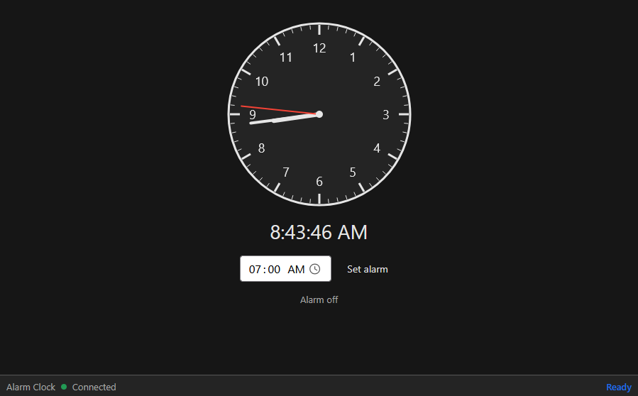
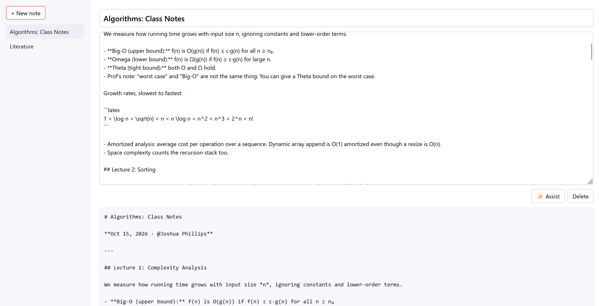
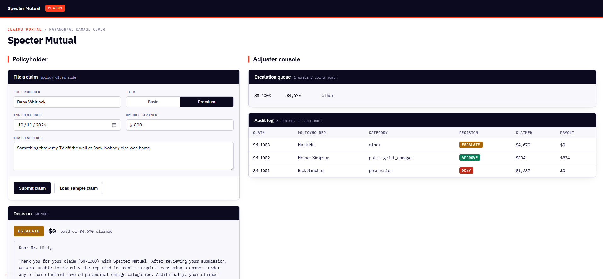

<div align="center">

<a href="https://rocketride-org.github.io/rocketride-workshops/">
  
</a>

<p>
  <strong>Hands-on RocketRide workshops, run from Jupyter notebooks in VS Code.</strong><br/>
  Build AI pipelines and the apps around them, then deploy to RocketRide Cloud, live from the notebook.
</p>

<p>
  <a href="https://rocketride-org.github.io/rocketride-workshops/"></a>
</p>

<p>
  
  
  
  
</p>

<p>
  <a href="https://github.com/rocketride-org/rocketride-workshops/actions/workflows/validate.yml"></a>
  <a href="https://discord.gg/PMXrtenMsY"></a>
</p>

</div>

<div align="center">

RocketRide's repeatable workshop kit. Workshop content is **Jupyter notebooks** you run in VS Code. You execute cells, and the build and the deploy to RocketRide Cloud happen live from the notebook.

The repo is organized as **modules**. A workshop is an ordered list of modules, so you download only the notebooks your workshop needs. Every notebook works as a single downloaded file.

</div>

## Projects

<div align="center">

<h3>Alarm clock: your first deployed app</h3>

<p>
  <a href="https://rocketride-org.github.io/rocketride-workshops/modules/alarm-clock/index.html"></a>
  &nbsp;
  <a href="https://github.com/rocketride-org/rocketride-workshops/tree/main/modules/alarm-clock"></a>
</p>

<p>Start a RocketRide project from an empty folder in three commands (<code>pip install rocketride</code>, <code>rocketride init</code>, <code>rocketride app create</code>), then ask Claude Code for an analog alarm clock: a ticking face, a time picker and an alarm that flashes and beeps. Watch it live in the App Builder, then deploy and publish it from the App Builder to your desktop on cloud.rocketride.ai.</p>




<p><sub><b>15 min</b> &nbsp;·&nbsp; rocketride init → app create → Claude builds the clock → deploy from the App Builder &nbsp;·&nbsp; needs Python 3.10+, Node 20+, pnpm 10+, Claude Code</sub></p>

</div>

<div align="center">

<h3>Notepad: RocketRide in an existing app</h3>

<p>
  <a href="https://rocketride-org.github.io/rocketride-workshops/modules/notepad-integration/index.html"></a>
  &nbsp;
  <a href="https://github.com/rocketride-org/rocketride-workshops/tree/main/modules/notepad-integration"></a>
</p>

<p>Wire a RocketRide pipeline into a small TypeScript notepad you didn't write. Clone it, run it, add the RocketRide TypeScript SDK, and copy and paste in an <b>✨ Assist</b> button that summarizes the open note in a few bullets with Claude.</p>




<p><sub><b>15 min</b> &nbsp;·&nbsp; rocketride init → clone and run the app → add the SDK → pipeline-backed Assist button &nbsp;·&nbsp; needs Python 3.10+, Node 20+, pnpm 10+, git</sub></p>

</div>

<div align="center">

<h3>Specter Mutual: zero to a deployed app</h3>

<p>
  <a href="https://rocketride-org.github.io/rocketride-workshops/modules/specter-mutual/index.html"></a>
  &nbsp;
  <a href="https://github.com/rocketride-org/rocketride-workshops/tree/main/modules/specter-mutual"></a>
</p>

<p>Build an AI claims reviewer for a fictional insurer that covers paranormal damage. A RocketRide agent reads each claim and recommends approve, deny or escalate, a policy engine of plain code holds it to the rules, and a claims portal puts it in front of people, deployed to your RocketRide workspace.</p>




<p><sub><b>40 min</b> in four parts &nbsp;·&nbsp; project init → pipeline build → UI build → cloud deploy &nbsp;·&nbsp; needs Python 3.10+, Node 20+, pnpm 10+</sub></p>

</div>

## How a module runs

Participants do every deterministic step **by hand, from the guide**, so they feel how little it takes to start and ship a RocketRide project. Notebooks hold only the build: pipelines, prompts, UI code and fallbacks. No exceptions. A module can also be guide-only: `notepad-integration` has no notebook, and participants paste every file from the guide.

| By hand, from the guide (`index.html`) | In the notebook |
| --- | --- |
| `pip install rocketride` (plus anything else the module needs) | Writing pipelines, app code and policy files |
| `rocketride init --uri https://api.rocketride.ai`: sign-in, `.env`, docs, `CLAUDE.md` | Running and trying pipelines with the SDK client |
| `rocketride app create <slug> --developer <id>`: the app scaffold | Skip-ahead cells that restore a stage's files |
| `git clone`, `pnpm install`, `pnpm add`, `pnpm dev` | |
| Viewing the app: open `apps/<slug>/<slug>.rrapp`, App Builder **Design → Preview** | |
| Deploying: App Builder **Deploy** tab → **Deploy** → **Publish to… @me** | |

`node scripts/validate.mjs` enforces the split. It fails any code cell that runs `%pip` or `pip install`, `rocketride init`, `app create`, `create_app(`, `verify_app(`, `add_app(`, `publish_app(`, `"pnpm"` or `"git", "clone"`, or that reads `os.environ`.

## Notebook conventions

Every module notebook uses the same Python 3.10+ kernel and lives in the participant's project folder, next to the `.env` that `rocketride init` wrote. The SDK reads that `.env` on its own: `client = RocketRideClient()`.

1. **Title and overview** (markdown): what you build, time box, what "done" looks like, and a link to the guide for the hand-run steps.
2. **Connect** (code): checks `.env` exists (else points to the guide), then opens one shared `client`.
3. **Stages**: a markdown cell (goal, what to watch for), then short code cells. Each stage ends with a cell headed `# Skip ahead: run this only if the stage above didn't work`, which writes the finished files so a stuck attendee can continue.
4. **What's next** (markdown): the guide's next step (preview, deploy), docs, Discord and the next module.

Rules:

- **Every cell is safe to re-run.** Writes overwrite, and pipelines attach to an existing task.
- **Self-contained.** No imports from sibling files. Anything the notebook needs, it writes itself. Files go in the project folder (`Path.cwd()`), under `apps/` and `pipelines/` like any RocketRide workspace.
- **No setup, no environment variables.** See the table above.
- **No secrets, no outputs in git.** Run `node scripts/strip.mjs` before you commit.
- Keep code cells short enough to read on a projector.

TypeScript work runs from the same Python kernel, through `%%writefile` cells (no TypeScript kernel).

A long module can split into parts. `<id>.ipynb` holds the overview and the shared helpers, and each part (`01-….ipynb`, `02-….ipynb`, …) starts with `%run ./<id>.ipynb` followed by `await connect()`. Keep `<id>.ipynb` free of top-level `await`: `%run` can't run it. Parts hand work to each other through files in the project folder, and a part's skip-ahead cell can rewrite its files with the shared `replay()` helper. `specter-mutual` is the example.

## Add a module

1. Create `modules/<id>/` with `<id>.ipynb`, `index.html`, `README.md` and `FACILITATOR.md`. The easiest start is a copy of an existing module. Start `README.md` with a `**Guide:**` link to `https://rocketride-org.github.io/rocketride-workshops/modules/<id>/`.

   The guide (`index.html`) keeps the same phases as every other project: **Start here**, **Set up at home**, **Start the project** (the hand-run commands, each in a copyable block), the build, the finish (**Deploy from the App Builder**, or clean up), and **Words you will hear** as reference. Each phase is a `<section class="phase" data-title="..." data-dur="<minutes>">`. The rail, pager and progress are built by `assets/codelab.js`; give `<body>` a unique `data-key` so progress is saved per guide.
2. Add an entry to `window.MODULES` in `workshops.js`:

   ```js
   "<id>": {
     title: "...",
     summary: "...",
     duration: 10,                       // minutes; workshop totals are computed from these
     notebook: "modules/<id>/<id>.ipynb",
     guide: "modules/<id>/index.html",
     requires: ["python"]                // plus "node", "pnpm", "git" if needed
   }
   ```

3. Clean and check:

   ```sh
   node scripts/strip.mjs
   node scripts/validate.mjs
   ```

## Compose a workshop

A workshop is only a manifest entry. Add it to `window.WORKSHOPS`:

```js
{
  id: "<workshop-id>",
  title: "...",
  summary: "...",
  funnel: "cloud",          // cloud | local
  status: "draft",          // live | draft (drafts show on the hub with ?drafts=1)
  modules: ["alarm-clock", "specter-mutual"]
}
```

Then run `node scripts/validate.mjs`. CI runs the same check on every push and pull request.

## Internal notes

Facilitator material that must not be public goes in `.internal/`, which is gitignored. The validator fails if anything under it, or any `.env` file, is tracked.
